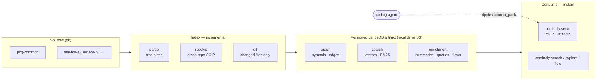

<p align="center">
  <picture>
    <source media="(prefers-color-scheme: dark)" srcset="https://raw.githubusercontent.com/sayef/comindly/main/assets/banner-dark.svg">
    
  </picture>
</p>

<p align="center">
  One versioned graph of all your team's repositories, in your own storage, served to coding agents over MCP.<br>
  Who breaks if this changes, which services call this route, and what the team already learned about this code.
</p>

<p align="center">
  <a href="#quick-start">Quick start</a> ·
  <a href="https://comindly.pages.dev/">Docs</a> ·
  <a href="https://comindly.pages.dev/reference/mcp/">MCP tools</a> ·
  <a href="ARCHITECTURE.md">Architecture</a> ·
  <a href="CHANGELOG.md">Changelog</a> ·
  <a href="CONTRIBUTING.md">Contributing</a>
</p>

<p align="center">
  <a href="https://github.com/sayef/comindly/actions/workflows/ci.yml"></a>
  <a href="https://crates.io/crates/comindly"></a>
  <a href="https://docs.rs/comindly"></a>
  
  <a href="LICENSE"></a>
</p>

<p align="center">
  <picture>
    <source media="(prefers-color-scheme: dark)" srcset="https://raw.githubusercontent.com/sayef/comindly/main/docs/assets/screenshots/explorer-dark.webp">
    
  </picture>
</p>

Comindly indexes a whole team's repositories into one versioned knowledge graph, then serves it to
coding agents (Claude Code, Cursor, …) over MCP. Unlike grep or per-repo search, it answers
*structural, cross-repo* questions deterministically:

- **Who breaks if I change this?** — org-wide blast radius (`ripple`)
- **What's the minimal context to change X safely?** — token-budgeted read-set (`context_pack`)
- **How does this flow work?** — a call-trace walkthrough (`flow`)
- **Where across the org is this used / how do I …?** — hybrid search + a pre-generated question catalog

Written in Rust. One static binary. No server to run, no per-developer re-indexing.

## Why it's different

- **Deterministic graph, not fuzzy RAG.** Calls, imports, inheritance and instantiation come from
  the AST (tree-sitter) — exact, reproducible, cheap to build. Python, TypeScript/JavaScript, Go,
  Java, Kotlin and Rust. Where a repo has a SCIP index (or a SCIP indexer is installed), its
  compiler-grade answers take precedence.
- **Cross-repo by design.** A global symbol identity (SCIP scheme) links a definition in one repo to
  its users in every other. `ripple` gives blast radius across the whole org.
- **Built once, read everywhere.** CI builds a new atomically-versioned index (local dir or S3);
  every agent reads the same fresh artifact. Incremental — only changed files/symbols are recomputed.
- **Graph-aware hybrid search.** Local static embeddings (Model2Vec) + BM25 + a dependency-graph
  **centrality** signal no pure search tool has.
- **Provider-agnostic LLM enrichment.** Optional summaries, question catalogs, and flow walkthroughs
  via [Rig](https://github.com/0xPlaygrounds/rig) — OpenAI, any OpenAI-compatible endpoint, or a
  local model.

## Install

Prebuilt binaries (macOS arm64/x64, Linux x64/arm64) are published to
[GitHub Releases](https://github.com/sayef/comindly/releases) on each `vX.Y.Z` tag:

```bash
curl -LsSf https://raw.githubusercontent.com/sayef/comindly/main/scripts/install.sh | sh
```

Or from [crates.io](https://crates.io/crates/comindly) (needs Rust 1.95 or newer, plus `protoc` and `cmake`):

```bash
cargo install comindly
```

Or from source:

```bash
git clone https://github.com/sayef/comindly && cd comindly
cargo build --release      # → target/release/comindly

# Try the deterministic engine on any repo, no network/S3 needed:
cargo run --example index_and_search -- ../some-repo
```

## Quick start

Zero-config: with no `--index-dir`, comindly reads and writes a default index location
(`~/.local/share/comindly`, XDG-aware — see `comindly config path`).

```bash
comindly index .                          # index this repo → default index dir (embeds by default)
comindly search "how do we connect to postgres"   # search it, no path needed
comindly serve                            # MCP server over the default index
```

Explicit location — a local dir or `s3://…`, shared across a team. The **same `--index-dir`**
builds and reads it (comindly manages the internal dataset layout):

```bash
# 1. Build the org index from several repos (embeddings + LLM enrichment/flows/guide run by
#    default when OPENAI_API_KEY is set; add --no-enrich / --no-flows / --no-guide to skip, or --no-llm for all)
comindly link ../pkg-common ../service-a --index-dir ./comindly-index/org

# 2. Explore / search the prebuilt index (instant, no re-parse)
comindly explore Settings --index-dir ./comindly-index/org        # zoom + ripple + context pack
comindly search  "how do we connect to postgres" --index-dir ./comindly-index/org
comindly flow    run_migrations --index-dir ./comindly-index/org  # flow walkthrough + call trace

# 3. Serve it to an agent over MCP
comindly serve --index-dir ./comindly-index/org
```

Register it with your agent. Claude Code:

```sh
claude mcp add --scope user comindly -- comindly serve --index-dir ./comindly-index/org
```

Cursor, Codex, VS Code and other MCP clients: see [Getting started](https://comindly.pages.dev/getting-started/),
or open `comindly ui --web` → **Connect**, which fills in your index path and checks your setup.

**MCP tools (15):**
- **Navigate:** `search`, `find`, `zoom`, `thread`, `flow`, `repos`, `suggest`.
- **Before a change:** `ripple` (blast radius, across repos and service contracts), `context_pack` (minimal read-set + known constraints), `preflight` (constraints, dead ends, contracts, missing companions for a planned edit), `contracts` (HTTP routes, queues, buckets, tables and who uses them), `guide` (measured conventions and recipes).
- **Reasoning ledger:** `why` (recorded decisions, failed attempts and constraints about a symbol), `remember`, `review`.

Results are handed to the agent as **markdown by default** (structured JSON is also attached; use `serve --format json` for raw JSON). Hooks, the ledger, self-enforcing constraints, signing and privacy are described in the **[docs](https://comindly.pages.dev/)** ([guides](docs/guides/)).

## In the app

`comindly app` (macOS) or `comindly ui --web` shows the same graph to people: the org map, contracts, the
ledger, packages and search. Shown here on the example shop in [`examples/acme`](examples/acme).

<p align="center">
  <picture>
    <source media="(prefers-color-scheme: dark)" srcset="https://raw.githubusercontent.com/sayef/comindly/main/docs/assets/screenshots/overview-dark.webp">
    
  </picture>
  <picture>
    <source media="(prefers-color-scheme: dark)" srcset="https://raw.githubusercontent.com/sayef/comindly/main/docs/assets/screenshots/contracts-dark.webp">
    
  </picture>
</p>
<p align="center">
  <picture>
    <source media="(prefers-color-scheme: dark)" srcset="https://raw.githubusercontent.com/sayef/comindly/main/docs/assets/screenshots/ledger-dark.webp">
    
  </picture>
  <picture>
    <source media="(prefers-color-scheme: dark)" srcset="https://raw.githubusercontent.com/sayef/comindly/main/docs/assets/screenshots/palette-dark.webp">
    
  </picture>
</p>

## Commands

| Command | Purpose |
|---|---|
| `comindly index <repo> [--enrich] [--flows] [--guide] [--no-embed] [--incremental]` | Index a single repo (embeds by default) |
| `comindly link <repos…> [--enrich] [--flows] [--guide] [--no-embed] [--incremental]` | Link several repos (cross-repo edges + blast radius) |
| `comindly explore <focus> [--index-dir <dir>]` | Zoom, blast radius, and context pack for a symbol |
| `comindly search <query…> [--repo <name>] [--index-dir <dir>] [--format md\|table]` | Graph-aware hybrid code search |
| `comindly find <query> [--repo <name>…] [--index-dir <dir>]` | Locate symbols by name/path substring |
| `comindly repos [--index-dir <dir>]` | List indexed repositories + symbol counts |
| `comindly stats [--repo <name>…] [--index-dir <dir>]` | Per-repo stats: symbols, edges, kinds, enrichment coverage |
| `comindly guide [--repo <name>…] [-o <file>] [--index-dir <dir>]` | Per-repo inferred coding style guides (built with `--guide`) |
| `comindly flow <focus> [--index-dir <dir>]` | Pre-generated flow walkthrough + live call trace |
| `comindly changed <repo> [--since <sha>]` | Files changed since a commit (git diff) |
| `comindly serve [--index-dir <dir>] [--format md\|json]` | MCP server over stdio |
| `comindly contracts [--type http\|sqs\|sns\|s3\|table] [--dangling]` | Service contracts with providers and consumers (FastAPI, Next.js, Express, Spring MVC, Feign, RestTemplate, WebClient, Go net/http/gin/echo/chi, axum, actix, reqwest, httpx/requests/fetch/axios, boto3, SQL; Terraform queues/topics/buckets and subscriptions) |
| `comindly packages [--skew]` | Internal packages: publisher, consumers, version skew |
| `comindly conventions [--repo <name>]` | Measured conventions, org baseline, recipes from history, and the team's own (each with an id) |
| `comindly conventions add "<rule>" [--repo <name>] [--dimension <d>] \| edit <id> "<rule>" \| rm <id> \| restore <id>` | Add a team convention, rewrite or hide one (measured ones can be restored); stored under `<index>/_conventions/`, untouched by re-indexing |
| `comindly preflight [repo] [--base <rev>] [--strict]` | Before committing or in MR CI: constraints, dead ends, failing checks, contracts, blast radius, missing companions ([MR job](docs/guides/ci.md#merge-request-preflight)) |
| `comindly remember <kind> --on <symbol> --title …` | Record a decision, failed attempt, constraint, gotcha, intent or question |
| `comindly why <symbol>` | Reasoning blame for a symbol (status, trust, evidence) |
| `comindly review <id> <confirm\|archive\|invalidate\|supersede\|dispute> [--reason "…"]` | Act on a ledger record; `comindly erase <id>` deletes one |
| `comindly ledger [--inbox] [--check] [--compact]` | All ledger records, only those needing review, evaluate constraint checks (non-zero exit on a violated `must`, for CI), or fold the inbox into the Lance snapshot |
| `comindly erase <id…> \| --actor <id\|me> [--yes]` | Erase ledger records (and relations about them) for good, including old snapshot versions; dry run without `--yes` |
| `comindly doctor` | Check this machine's setup: index and ledger reachable, local mirror, hooks, LLM key, GitLab token, signing, SCIP indexers |
| `comindly hook claude <event>` / `comindly init-hooks claude` | Claude Code hook adapter / config snippet |
| `comindly eval graph [--scip <dir>]` | Graph quality on the gold fixture (precision/recall per edge kind) |
| `comindly repos [add <folders…> [--branch b] \| remove <names…> \| scan <dir>]` | Indexed repositories, and the list `comindly link` indexes when given no folders |
| `comindly app [--index-dir <dir>]` | The UI in its own window (macOS) |
| `comindly team [set k=v… \| key]` | Team settings stored with the index (LLM, embedding model, LLM steps); `key` stores your own API key |
| `comindly join <index> [--profile p]` | Use a team's index on this machine |
| `comindly ui [--web [--port 7878] [--open]] [--index-dir <dir>]` | Terminal UI (incl. a ledger timeline), or a local web UI on 127.0.0.1 (overview, contracts, ledger review, explorer with a neighbourhood graph, conventions) |
| `comindly config <path\|init>` | Show or scaffold the config file |

Run `comindly <command> --help` for the full flags of any subcommand.

`--index-dir` is a local directory or an `s3://…` path; it is optional and defaults to the
configured index location. **All build steps default on** (`embed`, `enrich`, `flows`, `guide`);
each has a `config.toml` default and a `--x` / `--no-x` override (CLI wins). Embeddings are local;
`enrich`/`flows`/`guide` call an LLM (cost + send code, need `OPENAI_API_KEY`) — they **skip
automatically with a warning when no key is set**, so a keyless `index` still builds the graph +
search. Cap LLM cost with `max_enrich` / `max_flows` in `config.toml`.

## How it works

Build the index once (in CI or locally); every consumer reads the same versioned artifact.



Single crate, one module per stage — see [`ARCHITECTURE.md`](ARCHITECTURE.md) for the design and the
competitive landscape.

```
src/model.rs   SCIP identity, Symbol/Edge model
src/parse.rs   tree-sitter walk → symbols, structure, per-file facts
src/lang/      per-language adapters: Python, TypeScript/JS, Go, Java, Kotlin, Rust
src/packages.rs module names from pyproject / package.json / tsconfig / go.mod / Cargo.toml
src/resolve.rs binder: imports, re-exports, type flow, inheritance — within and across repos
src/scip.rs    SCIP ingestion (existing index.scip or installed indexers)
src/eval.rs    graph-quality eval on a gold fixture (`comindly eval graph`)
src/conventions.rs measured coding conventions + org baseline; src/recipes.rs change recipes from history
src/ledger.rs  reasoning ledger: decisions, failed attempts, constraints anchored to symbols (`why`, `remember`)
src/checks.rs  compiled constraint checks evaluated on the graph and manifests (`ledger --check`, preflight)
src/web.rs     local web UI (`comindly ui --web`): JSON API + the embedded React app from ui/
src/git.rs     git change detection (incremental)
src/index.rs   versioned LanceDB store: symbols, edges, search, enrichment, flows, style guide
src/graph.rs   in-memory petgraph: ripple / thread / zoom / context_pack
src/embed.rs   Model2Vec embeddings + code-aware hybrid ranking
src/search.rs  hybrid retrieval (BM25 + vector + graph centrality)
src/llm.rs     LLM summaries / questions / flow walkthroughs (opt-in, provider-agnostic via Rig)
src/mcp.rs     MCP server (15 tools)
src/main.rs    the comindly binary (CLI)
```

## CI

[`.github/workflows/comindly-index.yml`](.github/workflows/comindly-index.yml) (and
[`docs/guides/ci.md`](docs/guides/ci.md), with a GitLab variant) builds the shared index on a schedule: it clones
the listed repos and runs `comindly link … [--enrich] [--incremental]`, publishing the result
as a downloadable artifact (or to S3). Lance's version manifest is the atomic "latest" pointer every
consumer reads.

## Configuration

Persistent, non-secret defaults live in `config.toml` (`comindly config path` shows where; `comindly
config init` scaffolds it). Precedence, highest first: **CLI flag → environment variable → config
file → built-in default**.

```toml
index_dir   = "~/.local/share/comindly"   # default --index-dir (local path or s3://…)
llm_model   = "gpt-6-luna"   # any OpenAI-compatible model id
embed_model = "minishlab/potion-base-8M"
format      = "md"    # default when --format is absent (search: md|table, serve: md|json)
embed       = true    # index/link step defaults; CLI --x / --no-x override
enrich      = true    # LLM per-symbol summaries + queries (cost + sends code)
flows       = true    # LLM flow walkthroughs (cost + sends code)
guide       = true    # evidence-based style guide (cost + sends code)
# llm_base_url = "http://localhost:11434/v1"   # Ollama / vLLM / LiteLLM proxy
# max_enrich  = 200   # cap --enrich symbols (omit = no cap, whole codebase)
# max_flows   = 50    # cap --flows narrations (omit = no cap)
# scip        = "auto"   # auto | require | off
# cache_ttl_secs = 300   # how often serve/ui check for a new index version; hooks' local mirror
# signing_key = "~/.ssh/id_ed25519.pub"   # sign ledger records (default: git user.signingkey)
# allowed_signers = "~/.config/git/allowed_signers"   # verify them (default: git config)
```

Environment overrides: `COMINDLY_INDEX_DIR`, `COMINDLY_LLM_MODEL`, `COMINDLY_EMBED_MODEL`,
`COMINDLY_LLM_BASE_URL`, `COMINDLY_FORMAT`.

**Secrets stay in the environment**, never the file: `--enrich`/`--flows` use an LLM via Rig
(default OpenAI, `OPENAI_API_KEY`; any OpenAI-compatible endpoint via `COMINDLY_LLM_BASE_URL`). For an
`s3://…` index, AWS credentials/region come from the standard AWS environment (`AWS_ACCESS_KEY_ID`,
`AWS_SECRET_ACCESS_KEY`, `AWS_REGION`, or an SSO profile).

## Status

Engine: parse → resolve (tree-sitter + SCIP) → index → graph → embed → enrich → search → serve,
git-incremental at repo and org level. On top: the service-contract graph (HTTP, queues, topics,
buckets, tables, Terraform), conventions and recipes, the reasoning ledger (records, staleness,
self-enforcing checks, signing, erasure), preflight, and terminal and web
UIs. Progress and open items: [`docs/design/roadmap.md`](docs/design/roadmap.md).

## Development

```bash
cargo test
cargo fmt --all
cargo clippy --all-targets -- -D warnings
```

Pre-commit hooks (fmt + clippy + basic file checks) live in `.pre-commit-config.yaml` — install
with `pre-commit install`, or the Rust-native `prek install` (both read the same file).

## License

MIT.
